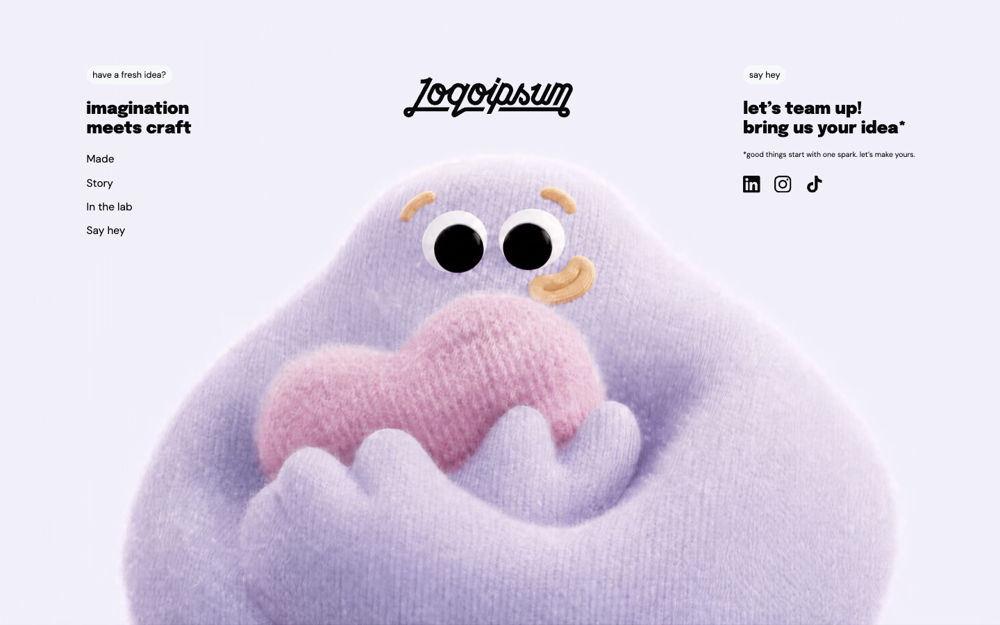
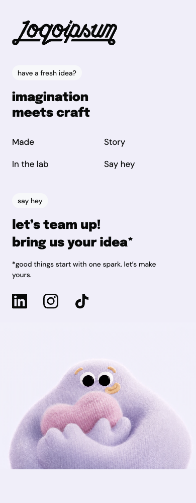

# Playful Idea

A responsive creative studio footer built with Next.js, React, and TypeScript. A lavender character fills the background on desktop; its recorded gaze follows the pointer by seeking to calibrated video frames. On mobile, the video appears below the content and plays on a loop, respecting reduced-motion preferences.

## Screenshots

### Desktop



### Mobile



## Getting started

Install dependencies and start the development server:

```bash
npm install
npm run dev
```

Open [http://localhost:3000](http://localhost:3000).

To build and run the production version:

```bash
npm run build
npm start
```

## Project structure

- `app/page.tsx` — footer content and layout.
- `app/footer-background.tsx` — responsive video playback and pointer-driven seeking.
- `app/gaze-frames.json` — calibrated gaze directions and frame times.
- `app/globals.css` — typography and responsive styles.
- `public/` — locally served fonts, icons, logo, and video assets.

The navigation labels and social icons are visual elements and do not link to external destinations.
